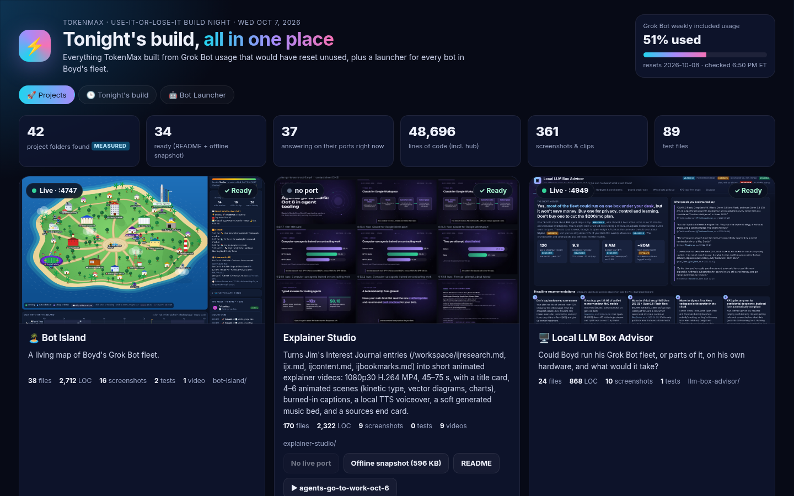
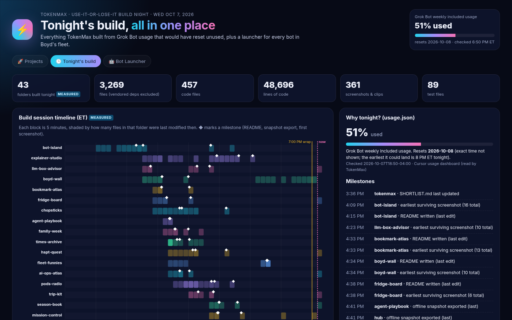
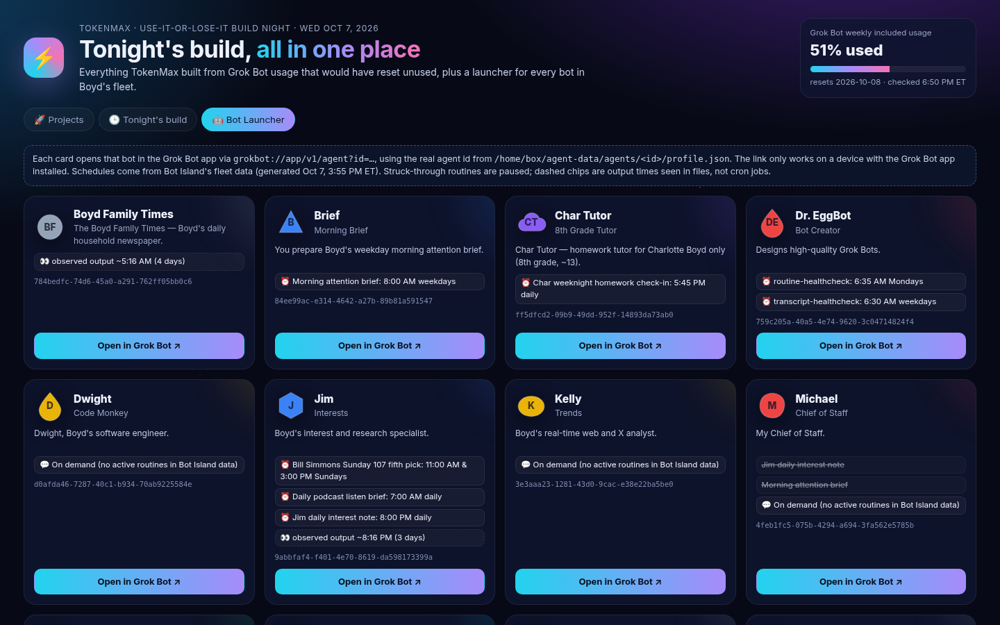
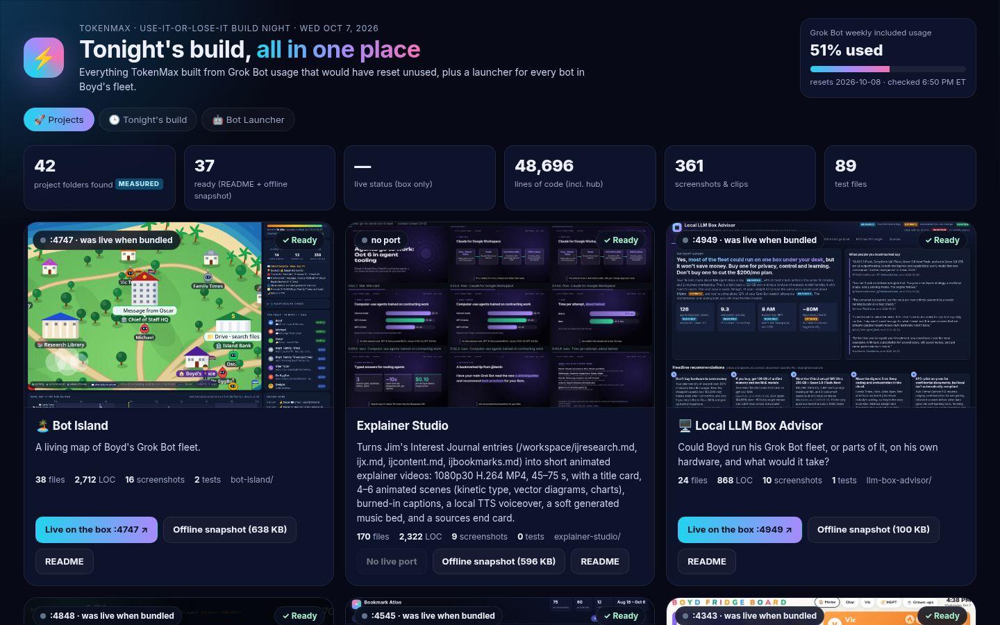

# TokenMax Hub

**One launch screen for everything TokenMax built on Oct 7, 2026, plus a one-tap launcher for every Grok Bot in Boyd's fleet.**

Live at **http://127.0.0.1:4646** on the box (`./run.sh` to start, `./stop.sh` to stop). The offline version is
`/workspace/tokenmax/TokenMax-Oct7-build.zip`: unzip it and open `TokenMax-Oct7-build/index.html`.



## What's on it

| Tab | What it shows | Where the data comes from |
|---|---|---|
| 🚀 **Projects** | A card per project folder in `/workspace/tokenmax`, each with a cover screenshot, one-line pitch, live/offline status dot, an *Open live :port* link, the offline snapshot link, the README and any videos. Folders with no `README.md` + `dist/*snapshot*.html` yet show as **Still building** and list what's missing. | Folder scan on every request. Pitch = first bold phrase (or first sentence) of the README's first paragraph. Port = `config.json` "port", else the first `PORT=`/`:NNNN` in README/run.sh/server.py. Status = a server-side GET of `/api/health`, then `/`, then a TCP connect. |
| 🕒 **Tonight's build** | `usage.json` gauge, measured totals, a 5-minute-bucket timeline of file activity from 3 PM ET to the 7 PM wrap (◆ milestones: README written, snapshot exported, first screenshot), and a per-project table of files / code files / LOC / screenshots / tests / size. | File mtimes and counts, all measured. Vendored folders (`vendor*`, `.venv`, `node_modules`, `__pycache__`…) are excluded. |
| 🤖 **Bot Launcher** | A card per bot: avatar (shape + color from the profile), name, role, one-liner, schedule chips, agent id, and an **Open in Grok Bot** button. | `profile.json` under `/home/box/agent-data/agents/*/` (read only). Role = `title`, else the first sentence of `description`. Schedules come from Bot Island's `data/fleet.json`: enabled routines as ⏰ chips, paused ones struck through, observed output times (not cron jobs) as dashed 👀 chips. |

Each bot button is exactly `grokbot://app/v1/agent?id=<agent id>`, where the id is the profile folder name. No other link format is used, and the smoke test checks this. The link only does something on a device with the Grok Bot app installed.

New projects show up automatically: drop a folder into `/workspace/tokenmax/` and it gets a card. Once it has a `README.md` and a `dist/*snapshot*.html` it flips to **Ready**. The page re-scans every 30 s.

## Honesty notes
- **Timeline = last-modified times.** A file edited ten times shows only its last edit, so early work is under-represented. "First file touched" is the oldest *surviving* mtime.
- **LOC** counts lines in `.py .js .mjs .ts .html .css .sh` outside `dist/ data/ out/ screenshots/ assets/ tts/ reports/` and vendored dirs. Generated snapshots, data files and build bundles (any code file over 200 KB, e.g. a `game.js` with three.js inlined) are not counted as code.
- **Tests** = files under `tests/` or named `test_*` / `*smoke*`.
- **Live status** reflects the moment of the scan. In the offline bundle it reads "was live when bundled".
- The usage gauge is whatever `usage.json` says (written by TokenMax from the usage dashboard). The hub doesn't read any account itself.

## Files
```
hub/
  server.py        stdlib HTTP server: /api/health, /api/hub, /p/<project>/<media|html|md> (read-only, traversal-guarded), static web/
  scan.py          all measurement: projects, story/timeline, bots  (python3 scan.py prints a summary)
  web/             index.html, style.css, app.js  (same files power live + offline; offline reads window.HUB_SNAPSHOT)
  bundle.py        builds /workspace/tokenmax/TokenMax-Oct7-build.zip (+ staging copy in dist/bundle-preview/)
  screenshot.sh    1440x900 headless-Chrome captures -> screenshots/
  rebundle.sh      refresh screenshots + zip. Tonight it is also auto-run at 5:30, 6:15 and 6:50 PM ET by data/rebundle-schedule.sh (log: data/rebundle.log)
  run.sh / stop.sh start (idempotent, background) / stop
  tests/smoke.py   31 checks: API, deeplinks vs profile folders, rendered DOM per tab, zip contents & size  (tests/run.sh)
```

## The bundle
`python3 bundle.py` writes `TokenMax-Oct7-build.zip` containing:
- `index.html` (+ `app.js`, `style.css`): the offline hub, with data embedded and all links relative
- `projects/<name>/dist/*snapshot*.html`: every project's offline snapshot that exists
- `projects/<name>/README.md` and `projects/<name>/screenshots/*`
- videos (`*.mp4`): explainer videos first, smallest first, added only while the zip stays under ~95 MB. Skipped videos are listed in `MANIFEST.md` and dropped from the offline index so no link breaks. Render scratch (`.work*`, `tmp*` dirs, files under 50 KB) is never treated as a video.
- `hub/README.md`, `hub/screenshots/*`
- `MANIFEST.md`: every file with its size, plus anything skipped and why

## Screenshots
| | |
|---|---|
|  |  |
|  |  |


---
## Repo notes
- **Built:** Oct 7, 2026, by TokenMax (Boyd's Grok Bot) on the Grok Bot box.
- **Run:** `./run.sh` (then open the localhost URL it prints).
- Imported from `/workspace/tokenmax/hub` on Oct 23, 2026. node_modules, virtualenvs, logs and files over 20 MB were left out.
